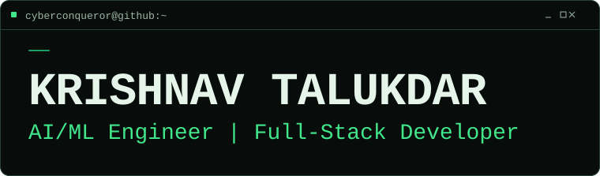
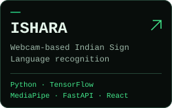
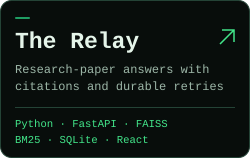
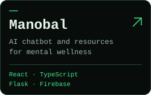
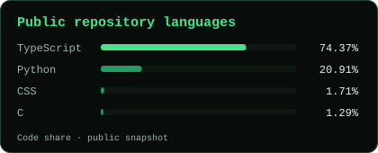

<p>
  
</p>

## About

```text
[focus]
build    = full-stack AI apps
explore  = computer vision + RAG
research = applied machine learning
```

I build AI tools that make information easier to access. I’m interested in how models behave inside real applications, from translating signs with a webcam to building research tools that show the evidence behind an answer.

## Featured projects

<p>
  <a href="https://github.com/CYBERCONQUEROR/ISHARA"></a>
  <a href="https://github.com/CYBERCONQUEROR/The-Relay"></a>
  <a href="https://github.com/CYBERCONQUEROR/Manobal-final"></a>
</p>

## Technical skills


| Area | Stack |
| --- | --- |
| Languages | `Python` `TypeScript` `C` |
| AI / ML | `scikit-learn` `OpenCV` `MediaPipe` `FAISS` |
| Deep learning | `TensorFlow` `Keras` `PyTorch` |
| Backend | `FastAPI` `Flask` |
| Frontend | `React` `Tailwind CSS` |
| Data | `SQLite` `Cloud Firestore` |
| Dev tools | `Docker` `Git` `Vite` |

## GitHub activity

<p>
  <a href="https://github.com/CYBERCONQUEROR#js-contribution-activity-description"></a>
  <a href="https://github.com/CYBERCONQUEROR?tab=repositories"></a>
</p>

<a href="https://github.com/CYBERCONQUEROR#js-contribution-activity-description"></a>

<a href="https://github.com/CYBERCONQUEROR#js-contribution-activity-description"></a>

## Achievements &amp; open source

| Work | Public record |
| --- | --- |
| **ISHARA** | Core contributor to model and system development. [Project credits](https://github.com/CYBERCONQUEROR/SIH2025#-contributors) |
| **The Relay** | Open-source research-paper QA and reliability dashboard. [MIT license](https://raw.githubusercontent.com/CYBERCONQUEROR/The-Relay/main/LICENSE) |
| **Portfolio** | Added a section introducing the team members. [Merged pull request](https://github.com/Karansn-dev/Portfolio/pull/1) |

## Contact

For open-source collaboration or project feedback, start with the relevant repository.

[Browse repositories](https://github.com/CYBERCONQUEROR?tab=repositories) · [Open an issue on The Relay](https://github.com/CYBERCONQUEROR/The-Relay/issues)

---

*“Start with the problem. Let the evidence shape the design.”*
